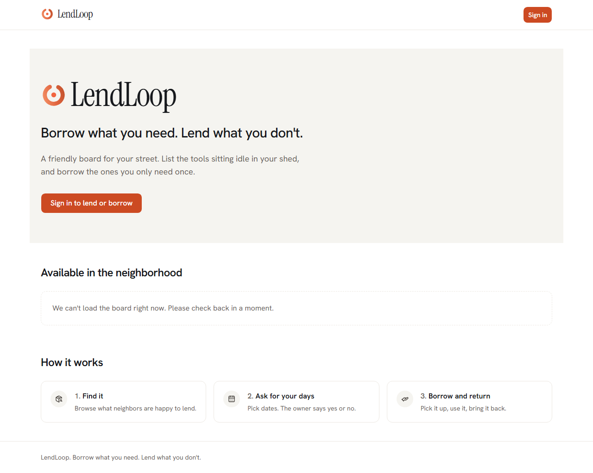
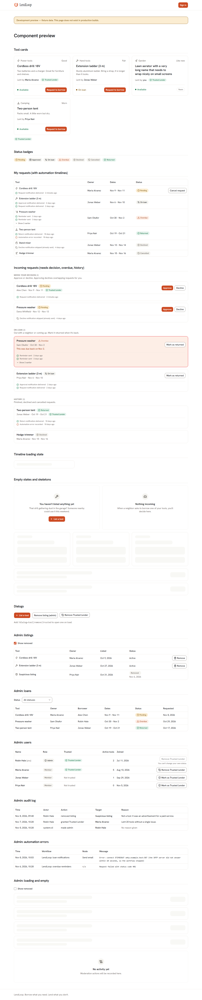
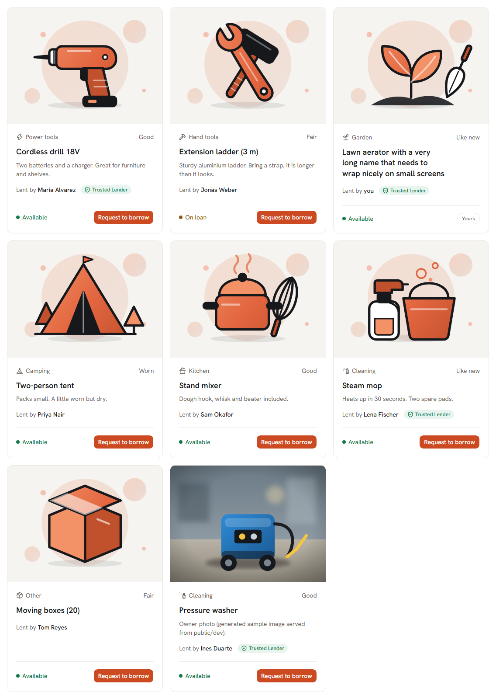
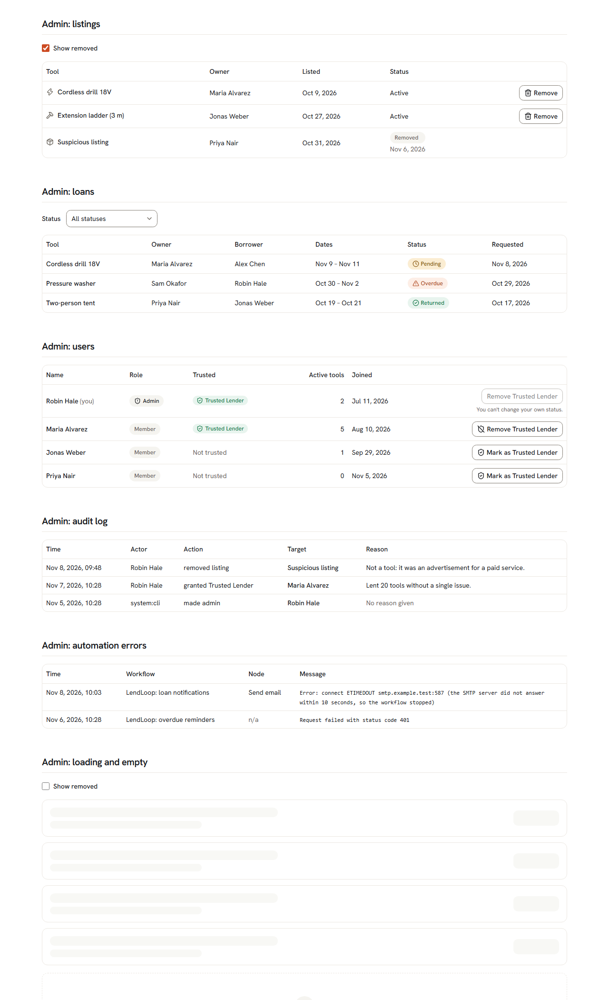
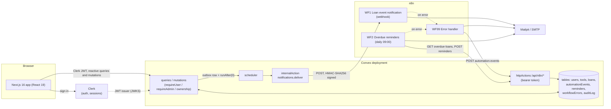
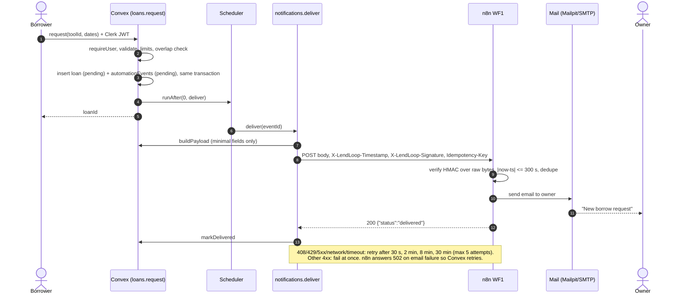
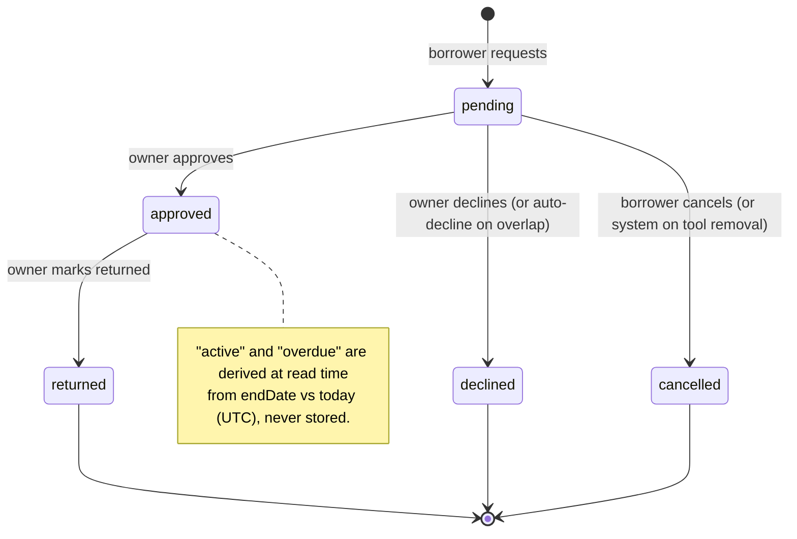

# LendLoop

**Borrow what you need. Lend what you don't.**

LendLoop is a neighborhood tool-lending board. Neighbors list tools they are willing to lend, request tools for a date range, and the owner approves, declines, and later marks the tool returned. Every loan event triggers an email through an n8n workflow, and overdue loans get a daily reminder.

## Live demo for reviewers

> TODO: fill in after the first deploy (placeholders only; no URLs are live yet).

- App: TODO (Vercel URL, `https://<project>.vercel.app`)
- Email inbox (Mailpit): TODO (Railway URL); the password is shared privately, never in this repo
- Sign up: any email works; addresses with `+clerk_test` accept the code `424242` (Clerk development instance, banner and 100-user cap apply)
- n8n editor: private to the owner (not shared)

How it is deployed, the environment matrix, secret rotation and known limits: [docs/DEPLOY.md](docs/DEPLOY.md).

| Doc | What is in it |
|---|---|
| [docs/DECISIONS.md](docs/DECISIONS.md) | 29 architecture decision records (ADR-001..029) |
| [docs/SECURITY.md](docs/SECURITY.md) | Security controls map with status and evidence |
| [docs/DEPLOY.md](docs/DEPLOY.md) | Runbook for the Vercel, Convex, Railway reviewer demo deployment |
| [docs/PRODUCTION.md](docs/PRODUCTION.md) | What must change before production |
| [n8n/README.md](n8n/README.md) | n8n setup, import/publish, gotchas |
| [n8n/E2E-RESULTS.md](n8n/E2E-RESULTS.md) | End-to-end test results for the automation |

## Contents

1. [Overview](#overview)
2. [Architecture](#architecture)
3. [Tech stack](#tech-stack)
4. [Repository layout](#repository-layout)
5. [Local setup](#local-setup)
6. [Environment variables](#environment-variables)
7. [Tests and checks](#tests-and-checks)
8. [n8n workflows](#n8n-workflows)
9. [Security and data minimization](#security-and-data-minimization)
10. [Accessibility and design](#accessibility-and-design)
11. [Known limitations](#known-limitations)
12. [Manual steps checklist](#manual-steps-checklist)

## Overview

**Roles**

- **Visitor** (signed out): sees the landing page and a teaser of available tools (name and category only).
- **Member** (signed in via Clerk): browses the board, lists own tools, requests tools for a date range, cancels own pending requests, approves/declines requests on own tools, marks returns.
- **Admin**: moderates (removes any tool, grants/revokes the "trusted lender" badge to others), sees users, tools, loans, the audit log, automation delivery status and workflow errors in `/admin`. Admins have no loan transitions and cannot edit other people's tools.

**Key features**

- Tool photos: owners can upload one optional photo per tool (JPG, PNG or WebP, up to 2 MB, validated server-side); tools without one show a category illustration.
- Tool board with category filter, owner "trusted lender" badge, booked date ranges on each tool.
- Loan lifecycle with a single state machine; approving a request auto-declines overlapping pending requests (ADR-014).
- Transactional outbox: every state change writes an event in the same transaction; delivery to n8n is retried with backoff.
- Per-loan automation timeline in the UI (delivered / retrying / failed), so a failed email is visible to the people involved.
- Overdue reminders (n8n schedule), idempotent per loan and day.
- Admin console with audit log, workflow-error list, and a Failed notifications section in the Automation errors tab with Retry (audited, `automation.retry`).
- Outbox safety net: a cron sweeper (every 10 min) re-drives events stuck in `pending`.

**Screenshots.** The public page is the real thing. Signed-in views are rendered through the dev-only `/dev/preview` route with fixture data (it returns 404 in production builds); the author did not exercise signed-in flows against a real Clerk instance (see [Known limitations](#known-limitations)).









Also in `docs/screenshots/`: `preview-mobile.png`, `public-mobile.png`, `preview-dialog-tool.png`.

## Architecture



**Borrow request to notification**



**Loan state machine** (`convex/lib/loanStateMachine.ts`; the only definition of transitions)



## Tech stack

Versions are the installed ones (`package.json` ranges resolve to these).

| Layer | Technology |
|---|---|
| Frontend | Next.js 16.4.5 (App Router, Turbopack, `proxy.ts`), React 19.3.0, TypeScript 5.9.3 (strict, `noUncheckedIndexedAccess`) |
| UI | Tailwind CSS 4.3.5, shadcn/ui (Radix), lucide-react, sonner, next-themes |
| Forms and dates | react-hook-form 7.91, zod 4.6, date-fns 4.4 |
| Auth | Clerk (`@clerk/nextjs` 7.9.25), native Convex integration (no JWT template) |
| Backend and DB | Convex 1.49.0 |
| Automation | n8n 2.46.6 (pinned in `n8n/docker-compose.yml`), Mailpit v1.33.0 (compose) |
| Tests | Vitest 5.1.0 (edge-runtime), convex-test 0.0.67 |
| Lint | ESLint 9 with `eslint-config-next` and `@convex-dev/eslint-plugin` |

## Repository layout

```
app/                    Next.js routes: / (landing), /dashboard/*, /admin, /dev/preview (dev only)
components/             App components; components/ui = shadcn primitives; admin/, loans/, tools/, providers/
hooks/ lib/             Frontend helpers (mutation toasts, error mapping, categories, dates)
convex/                 Backend: schema, tools, loans, users, admin, automation, notifications, maintenance, crons, http, seed
convex/lib/             Pure helpers and guards: auth, env (only env reader), hmac, dates, validation,
                        loanStateMachine, notify (outbox), toolRemoval, autoDecline, audit, errors
tests/                  Test-only helpers (not deployed with Convex)
scripts/                check-authz.mjs, scan-secrets.mjs, their self-tests, seed-clerk-users.mjs
n8n/code/               Source of truth for Code-node JavaScript
n8n/scripts/            build-workflows.mjs (generator), bootstrap.{mjs,sh,ps1}
n8n/workflows/          Generated workflow JSON (never hand-edit)
n8n/docker-compose.yml  n8n + Mailpit, loopback-bound
proxy.ts                Clerk middleware: route gating (UX only) and CSP
next.config.ts          Static security headers
docs/                   DECISIONS, SECURITY, PRODUCTION, DEPLOY, screenshots
```

## Local setup

**Prerequisites**: Node.js 24 or newer (n8n 2.46 requires it), npm, a free Clerk account, a free Convex account (or use Convex's anonymous local deployment). Docker is optional (only for the compose path).

### 1. Clone and install

```bash
git clone <repo-url> lendloop && cd lendloop
npm ci
```

### 2. Clerk

1. Create a Clerk application (any sign-in methods; email is enough).
2. In the Clerk dashboard open **Integrations**, **Convex**, and **activate** it. This makes Clerk issue session tokens Convex accepts and shows the **Frontend API URL / issuer domain** (like `https://<name>.clerk.accounts.dev`). No JWT template is needed (ADR-003).
3. From **API keys** copy the publishable key and the secret key.

### 3. Convex

```bash
npx convex dev
```

Log in and create a project, or choose a local anonymous deployment when prompted. This writes `NEXT_PUBLIC_CONVEX_URL` into `.env.local` and keeps pushing functions. Leave it running (it is also `npm run dev:convex`). In a second terminal set the deployment env (names are exactly those read in `convex/lib/env.ts`):

```bash
npx convex env set CLERK_JWT_ISSUER_DOMAIN https://<name>.clerk.accounts.dev
npx convex env set ADMIN_CLERK_USER_IDS user_xxxxxxxx            # optional, see step 7
npx convex env set N8N_WEBHOOK_URL http://localhost:5678/webhook/lendloop-loan-events
npx convex env set N8N_WEBHOOK_SECRET "$(node -e "console.log(require('crypto').randomBytes(32).toString('hex'))")"
npx convex env set N8N_INBOUND_TOKEN  "$(node -e "console.log(require('crypto').randomBytes(32).toString('hex'))")"
```

Keep the two generated secrets: n8n needs the same values (step 6). Both secrets must be at least 32 characters (shorter = treated as not configured), and `N8N_WEBHOOK_URL` must be `https:` unless the host is localhost, 127.0.0.1, host.docker.internal or [::1] (otherwise events fail with `INSECURE_WEBHOOK_URL`). Without `N8N_WEBHOOK_*` the app still works; events are marked failed with `NOT_CONFIGURED`. `convex.env.example` lists the same names.

### 4. `.env.local`

```bash
cp .env.example .env.local      # then fill:
# NEXT_PUBLIC_CONVEX_URL=...                 (already written by `convex dev`)
# NEXT_PUBLIC_CLERK_PUBLISHABLE_KEY=pk_test_...
# CLERK_SECRET_KEY=sk_test_...
```

### 5. Run the app

```bash
npm run dev:convex     # terminal 1 (if not already running)
npm run dev            # terminal 2 -> http://localhost:3000
```

### 6. n8n

Generate or reuse the two secrets from step 3, then pick one path. Full detail, env table and gotchas: [n8n/README.md](n8n/README.md).

**With Docker (n8n + Mailpit):**

```bash
cd n8n
cp .env.example .env     # set LENDLOOP_WEBHOOK_SECRET (= Convex N8N_WEBHOOK_SECRET)
mkdir -p secrets && printf %s "$(openssl rand -hex 32)" > secrets/n8n_encryption_key   # Docker secret file, never in .env; back it up
docker compose up -d
export LENDLOOP_INBOUND_TOKEN=<same as Convex N8N_INBOUND_TOKEN>
./scripts/bootstrap.sh   # Windows: .\scripts\bootstrap.ps1
docker compose restart n8n   # required: published webhooks are only registered after a restart
```

n8n: http://localhost:5678 (create the owner account on first visit). Mailpit: http://localhost:8025.

**Without Docker:** install `n8n@2.46.6` with npm in a separate folder, export the `LENDLOOP_*`, `NODE_FUNCTION_ALLOW_BUILTIN=crypto`, `N8N_BLOCK_ENV_ACCESS_IN_NODE=false`, `N8N_SECURE_COOKIE=false` variables, point `SMTP_HOST`/`SMTP_PORT` at any local SMTP catcher (e.g. a Mailpit binary on 127.0.0.1:1025), run `N8N_CMD="npx n8n" ./n8n/scripts/bootstrap.sh --local`, then `npx n8n start`. Exact commands are in the n8n README ("Setup without Docker"). The Docker path is also verified (see Known limitations).

The bootstrap creates credentials from env, imports the three workflows and publishes them. Local Convex serves HTTP actions on `http://127.0.0.1:3211`; hosted dev deployments use `https://<name>.convex.site` (set `LENDLOOP_CONVEX_SITE_URL` accordingly).

### 7. Seed data and first admin

Demo data (8 neighbors, 26 active tools across every category plus one removed tool, 17 loans in every state, delivered notification history, one failed notification, one workflow error, audit rows):

```bash
npx convex run seed:run                  # 8 placeholder users who CANNOT sign in (tokenIdentifier "seed|...")
npx convex run seed:run '{"notify":true}' # also enqueue real n8n deliveries for the 4 pending requests (default: none, so reseeding never sends email)
# or, to get users you can actually sign in as (Clerk TEST instance only):
CLERK_SECRET_KEY=sk_test_... SEED_PASSWORD='choose-a-demo-password' node scripts/seed-clerk-users.mjs
# --print only prints the `npx convex run seed:run '{...}'` command instead of running it
```

To start over (DEV deployments only, never production), enable the guard once, then reset and reseed:

```bash
npx convex env set ALLOW_SEED_RESET true
npx convex run seed:reset '{"confirm":"DELETE ALL DEV DATA"}'   # deletes every row in every table; repeat while it prints done:false
npx convex run seed:run '{}'
```

`seed:run` and `seed:reset` are `internalMutation`s (not callable by browsers). `seed:run` refuses to run when tools exist unless `{"force":true}`, which adds a second copy of every tool; prefer `seed:reset` then `seed:run`. `seed:reset` refuses unless `ALLOW_SEED_RESET` is exactly `true`. When you pass `clerkUsers` (what the Clerk script does), tools and loans are spread across those users. The Clerk script refuses non-`sk_test_` keys and creates `alex|sam|priya+clerk_test@example.com`; its Clerk API calls were written from Clerk's reference and not verified against a live instance by the author.

**First admin** (pick one):

- Sign in once, copy your Clerk user id (`user_...`, Clerk dashboard, Users), put it in `ADMIN_CLERK_USER_IDS` (step 3). You are promoted at your next sign-in/provisioning, with an audit row. Removing an id later does not demote (ADR-011).
- Or after signing in once: `npx convex run admin:promoteToAdmin '{"clerkUserId":"user_..."}'` (audited as `system:cli`; demote with `admin:demoteToUser`). The user must have signed in once: `promoteToAdmin` throws `NOT_FOUND` for an unknown Clerk id.

## Environment variables

Every variable read by code in this repo. "Required" means the feature fails without it.

| Name | Where | Required | Purpose | Example placeholder |
|---|---|---|---|---|
| `NEXT_PUBLIC_CONVEX_URL` | Next (`.env.local`) | yes | Convex deployment URL for the browser client; written by `convex dev` | `https://<name>.convex.cloud` |
| `NEXT_PUBLIC_CLERK_PUBLISHABLE_KEY` | Next | yes | Clerk publishable key (public by design) | `pk_test_...` |
| `CLERK_SECRET_KEY` | Next (server only) | yes | Clerk server key used by middleware | `sk_test_...` |
| `NEXT_PUBLIC_CLERK_SIGN_IN_URL` | Next | no | Only if you add a custom sign-in route (the app uses the modal) | `/sign-in` |
| `CLERK_JWT_ISSUER_DOMAIN` | Convex | yes | Issuer Convex trusts for JWTs (`convex/auth.config.ts`); also maps seeded Clerk users | `https://<name>.clerk.accounts.dev` |
| `ADMIN_CLERK_USER_IDS` | Convex | no | Comma-separated Clerk ids promoted to admin at provisioning | `user_abc,user_def` |
| `N8N_WEBHOOK_URL` | Convex | for emails | Workflow 1 production webhook URL; must be https unless host is localhost, 127.0.0.1, host.docker.internal or [::1] (else `INSECURE_WEBHOOK_URL`) | `http://localhost:5678/webhook/lendloop-loan-events` |
| `N8N_WEBHOOK_SECRET` | Convex | for emails | HMAC-SHA256 key for outbound signing; min 32 chars (shorter = not configured) | `<64 hex chars>` |
| `N8N_INBOUND_TOKEN` | Convex | for n8n callbacks | Bearer token required on `/api/n8n/*`; min 32 chars; unset or shorter = 503 | `<64 hex chars>` |
| `LENDLOOP_WEBHOOK_SECRET` | n8n | yes | Same value as Convex `N8N_WEBHOOK_SECRET`; used to verify signatures | `<64 hex chars>` |
| `LENDLOOP_CONVEX_SITE_URL` | n8n | yes | Base URL of Convex HTTP actions | `http://127.0.0.1:3211` |
| `LENDLOOP_MAIL_FROM` | n8n | yes | Email sender | `LendLoop <noreply@example.com>` |
| `LENDLOOP_ADMIN_ALERT_EMAIL` | n8n | yes | Recipient of error-workflow alerts | `admin@example.com` |
| `N8N_ENCRYPTION_KEY_FILE` | n8n (compose) | yes | Set by `docker-compose.yml` to the Docker secret `n8n/secrets/n8n_encryption_key` (create it, back it up); the key itself is never an env var or in `.env` | `/run/secrets/n8n_encryption_key` |
| `GENERIC_TIMEZONE` | n8n | no (UTC) | Timezone of the 09:00 schedule | `UTC` |
| `NODE_FUNCTION_ALLOW_BUILTIN` | n8n | yes | Must be `crypto` (Code node HMAC) | `crypto` |
| `N8N_BLOCK_ENV_ACCESS_IN_NODE` | n8n | yes | Must be `false` so nodes can read `$env.LENDLOOP_*` (ADR-025 trade-off) | `false` |
| `N8N_SECURE_COOKIE` | n8n | local only | `false` for plain-HTTP localhost (compose default); `true` behind HTTPS | `false` |
| `N8N_PROTOCOL` | n8n (compose) | no | Compose default `http`; set `https` behind TLS (with `N8N_SECURE_COOKIE=true`) | `http` |
| `LENDLOOP_INBOUND_TOKEN` | shell only (bootstrap) | yes for bootstrap | Becomes the n8n Header Auth credential; equals Convex `N8N_INBOUND_TOKEN` | `<64 hex chars>` |
| `SMTP_HOST`, `SMTP_PORT`, `SMTP_USER`, `SMTP_PASSWORD`, `SMTP_SECURE` | shell only (bootstrap) | host defaults to `mailpit`, port 1025 | Become the `LendLoop SMTP` credential | `mailpit`, `1025` |
| `LENDLOOP_TMP` | shell only (bootstrap, `scan-secrets-selftest`) | no | Temp directory for the bootstrap credentials file and self-test fixtures (default: OS temp dir) | `D:\tmp` |
| `N8N_CMD` | shell only (bootstrap) | no | Simple command used to run n8n (no spaces inside paths); `npx n8n` from the n8n install folder | `npx n8n` |
| `N8N_BIN` | shell only (bootstrap) | no | Path to `node_modules/n8n/bin/n8n` of a local install; runs it with node and no shell, so paths with spaces work (takes precedence over `N8N_CMD`) | `D:/tools/n8n/node_modules/n8n/bin/n8n` |
| `WORKFLOWS_DIR` | shell only (bootstrap) | no | Override workflow directory | (default `n8n/workflows`) |
| `CLERK_SECRET_KEY`, `SEED_PASSWORD` | shell only (`seed-clerk-users.mjs`) | for that script | Clerk TEST key (must be `sk_test_`) and demo password | `sk_test_...`, `<password>` |
| `N8N_RUNNERS_BROKER_PORT` | shell only | only when running `n8n execute` next to a live instance | Avoids port 5679 clash | `5689` |

Notes: `NODE_ENV` is read in `proxy.ts` (localhost Convex allowed in CSP outside production) and `app/dev/preview/page.tsx`. Never commit real values: `.env*` is git-ignored and `npm run scan:secrets` is a tripwire.

## Tests and checks

```bash
npm run check
```

runs, in order, and stops at the first failure:

| Step | Command | What it enforces |
|---|---|---|
| Typecheck | `npm run typecheck` | `tsc --noEmit`, strict |
| Lint | `npm run lint` | ESLint incl. Convex rules (no raw `process.env`, validators, duplicate indexes) |
| Authz guard | `npm run authz` | Tokenizer-based lint (ADR-030): every public `query`/`mutation`/`action` has an `// AUTH:` comment and calls a `require*` guard in code (comments/strings ignored); `public`/`identity-only` only for the reviewed `PUBLIC_ALLOWLIST` in `scripts/check-authz.mjs`; no public builders in `convex/lib/**` or tests; every `httpAction` calls `authorizeInbound(` which calls `verifyBearer(`. A lint, not a proof |
| Authz self-test | `npm run authz:selftest` | Runs the lint against fixtures in `scripts/__fixtures__/authz` and fails if a known bypass is accepted |
| Secret scan | `npm run scan:secrets` | Tripwire (ADR-038) for Clerk keys, `whsec_`, JWTs, Convex deploy keys, bearer tokens, private keys, secret-looking assignments, 64-hex strings, tracked `.env`, and credential data/pinData/long hex in `n8n/workflows/*.json`; fails on git errors and unreadable files; `scan-secrets:allow` on a line is the only escape hatch |
| Secret scan self-test | `npm run scan:secrets:selftest` | Generates known-bad fixtures at run time and fails if the scanner misses them |
| Tests | `npm test` | Vitest: 294 tests in 16 files (as of this writing) |

What the tests cover (all in `convex/**/*.test.ts`, using convex-test, no network):

- **Authorization matrix**: guards, ownership, NOT_FOUND vs FORBIDDEN, admin cannot edit tools or act on loans, projections contain no ids/emails (`auth`, `users`, `tools`, `loans`, `admin` tests).
- **State machine**: every `(from, to, actor)` combination, derived `active`/`overdue` (`loanStateMachine.test.ts`), dates and overlap edge cases (`dates.test.ts`), validation helpers.
- **Loan flows**: double-booking, auto-decline on approve, caps, soft-delete rules, outbox row per transition.
- **Crypto**: HMAC against RFC 4231 vectors, constant-time compare, bearer parsing (`hmac.test.ts`).
- **Delivery**: signing headers, retryable vs permanent codes, backoff, max attempts, `NOT_CONFIGURED`, payload minimization (`notifications.test.ts`).
- **HTTP endpoints**: bearer auth, 401/403-style cases, 413/400/405, idempotent reminders, error write-back sanitization (`http.test.ts`, `automation.test.ts`).
- **Seed**: loans in every state, refuses a second run without `force`, Clerk-user mapping, internal-only exports (`seed.test.ts`).

Not covered by automated tests: React components, proxy/CSP behavior, and the n8n workflows themselves (verified manually, see [n8n/E2E-RESULTS.md](n8n/E2E-RESULTS.md)). `npm run build` needs real Clerk keys and `NEXT_PUBLIC_CONVEX_URL`.

## n8n workflows

Generated from `n8n/code/*.js` by `node n8n/scripts/build-workflows.mjs`; never hand-edit the JSON.

| Workflow | Trigger | Does |
|---|---|---|
| **01 Loan event notification** (`lendloopWf01`) | Webhook `POST /webhook/lendloop-loan-events` | Verify headers and HMAC over raw bytes (constant time, 300 s window) -> dedupe -> compose escaped HTML + text email -> send (3 tries, 5 s) -> record event id -> `200 delivered`. Bad signature `401`, repeat `200 duplicate`, email failure `502` (Convex retries) |
| **02 Overdue reminders** (`lendloopWf02`) | Daily 09:00 (`GENERIC_TIMEZONE`) + manual trigger | `GET /api/n8n/overdue-loans` -> email each borrower -> `POST /api/n8n/reminders` with `sent`/`failed`. Idempotent per loan and day (server-computed key) |
| **99 Error handler** (`lendloopWf99`) | Error Trigger (set as `errorWorkflow` of 01 and 02) | Builds a redacted 300-char summary, emails the admin, writes `workflowErrors` and fails the linked event via `POST /api/n8n/automation-events` |

- **Import and publish**: `n8n/scripts/bootstrap.*` runs `import:credentials`, `import:workflow --separate`, `publish:workflow` for each file. Restart n8n afterwards, otherwise the production webhook returns 404.
- **Credentials** are created from environment variables by the bootstrap (temp file mode 0600 on POSIX, deleted afterwards; on Windows only directory ACLs apply, use `LENDLOOP_TMP`): `LendLoop SMTP` and `LendLoop Convex inbound` (Header Auth). Workflow JSON references them by `{id, name}` only; `scan:secrets` fails if anything more appears. The HMAC secret is an n8n env var, not a credential (ADR-025).
- **Evidence**: eight scenarios (valid event, HTML escaping, replay, bad/stale signature, real Convex-to-n8n delivery, overdue idempotency, inbound auth, error workflow, email outage with retry) passed on a local npm n8n 2.46.6 with an SMTP sink: [n8n/E2E-RESULTS.md](n8n/E2E-RESULTS.md).

## Security and data minimization

Standards targeted: OWASP ASVS 5.0 L2, Top 10 2025, API Top 10 2023. Full map with status: [docs/SECURITY.md](docs/SECURITY.md). Highlights:

| Area | Decision | Where | Tests |
|---|---|---|---|
| A01 / API1 / API5: access control | Convex is the security boundary; proxy gating is UX only. Every public function authenticates and checks ownership; identity comes from `ctx.auth` only | `convex/lib/auth.ts`, `scripts/check-authz.mjs`, ADR-004 | `auth.test.ts`, `tools.test.ts`, `loans.test.ts`, `admin.test.ts` |
| API1: IDOR | Foreign objects return `NOT_FOUND`, never `FORBIDDEN`, so ids cannot be probed. `FORBIDDEN` only for function-level checks (admin) | ADR-009 | `auth.test.ts` |
| API3: property exposure | Explicit field-by-field projections plus `returns:` validators; `ensureCurrent` takes no args; public teaser is exactly `{name, category}` | `convex/tools.ts`, `convex/users.ts` | deep key-scan tests |
| API4 / API6: resource and flow abuse | `take()` caps, length limits, max 30-day loans, 50 active tools and 10 creations/hour per user, 5 pending, 10 requests/hour and 2 per tool per 24h per borrower, bounded overdue scan, no self-borrow/double-booking | `convex/lib/validation.ts` (`LIMITS`), ADR-018/019/033/035 | `loans.test.ts`, `tools.test.ts` |
| A02: headers and CSP | HSTS (`max-age=63072000; includeSubDomains`, no preload, ADR-039), nosniff, Referrer-Policy, Permissions-Policy, X-Frame-Options, COOP static; CSP with nonce via Clerk middleware (`frame-ancestors 'none'`, `object-src 'none'`, scoped `connect-src`) | `next.config.ts`, `proxy.ts`, ADR-005 | manual |
| A04: cryptography | HMAC-SHA256 over `"<ts>.<rawBody>"`, 300 s replay window, constant-time compare (digest both sides), separate secret per direction | `convex/lib/hmac.ts`, `convex/notifications.ts`, ADR-021 | `hmac.test.ts`, E2E 1-3 |
| A07: authentication | Delegated to Clerk; JWT issuer pinned in Convex; fail-closed `UNAUTHENTICATED`/`USER_NOT_PROVISIONED`; admin by immutable Clerk id; env allowlist never auto-demotes | `convex/auth.config.ts`, ADR-010..012 | `users.test.ts`, `auth.test.ts` |
| A09: logging and audit | Logs carry ids and short codes only. `auditLog` records role changes, trusted flag changes and admin tool removal with actor and sanitized reason. Failures surface to admins (`listWorkflowErrors`, event status) | `convex/lib/audit.ts`, `convex/notifications.ts` (`log`) | `admin.test.ts`, `notifications.test.ts` |
| API10: unsafe consumption | Inbound n8n payloads validated and length-capped, text sanitized and email-redacted, 16 KB body cap, bearer checked before body is read, `no-store` | `convex/http.ts`, `convex/automation.ts` | `http.test.ts`, `automation.test.ts` |
| Secrets | Only in env (Clerk, Convex env, n8n env/credentials); `.env*` ignored; `convex/lib/env.ts` is the only reader; `scan:secrets` in `check` | `scripts/scan-secrets.mjs` | E2E 6 |

**Payload minimization.** The webhook body to n8n is exactly `eventId, eventType, loanId, toolName, loanStatus, startDate, endDate, recipient{name, email}`. No user ids, no description, no other party's email. The overdue list returned to n8n is exactly `loanId, toolName, borrowerName, borrowerEmail, endDate, daysOverdue, idempotencyKey`. n8n stores no successful execution data and prunes failures after 168 h (compose settings); the error workflow stores no payload.

**Public projection.** Signed-out visitors get `{name, category}` of active tools. Signed-in board data omits owner email and identity ids; borrower email is never sent to owners in the UI (only name and trusted flag).

## Accessibility and design

- WCAG 2.2 AA targets: skip link, one `h1` per page, semantic landmarks, visible focus ring, labelled form fields with error text, dialogs and alert dialogs from Radix (focus trap, Escape), status badges use icon plus text label (never color alone), `prefers-reduced-motion` honored, responsive down to phone width.
- Contrast: form-control borders >= 3:1, body and muted text >= 4.5:1.
- Palette: brand colors and fonts (Hanken Grotesk, Instrument Serif) adapted from onefinops.com at the client's request (no logo or name copied). The brand orange `#F1643F` reaches only about 3.2:1 with white text, so buttons and links use `#CC4A22` (about 4.6:1) and the original orange is limited to non-text accents. Light-only. See ADR-024.
- Not audited with a screen reader or automated axe run by the author.

## Known limitations

Honest list; most are deliberate scope cuts with a production path in [docs/PRODUCTION.md](docs/PRODUCTION.md).

- **Docker path verified, with caveats**: `n8n/docker-compose.yml` (n8n 2.46.6 + Mailpit v1.33.0) and the container bootstrap were run end to end on Windows 11 with Docker Desktop 29.9.2 (Compose 5.6.1): both services `healthy`, the full API E2E passed 75/75 ([results](docs/E2E-API-RESULTS.md#docker-run)). Not verified: Linux hosts (the encryption key secret file must be `chmod 644` there because the container user is uid 1000) and a Linux-native `host.docker.internal` (relies on the `host-gateway` extra host). The earlier npm n8n run is in [E2E-RESULTS](n8n/E2E-RESULTS.md).
- **Signed-in flows not exercised against a real Clerk instance** by the author. Convex logic is covered by tests with mocked identities; signed-in UI was reviewed through `/dev/preview` fixtures, and `scripts/seed-clerk-users.mjs` is unverified against live Clerk.
- **`take()` caps instead of pagination** (200 tools, 100 loans per list); no search index (ADR-018).
- **Rate limits are in-transaction business counts**, not call-volume limiting; failed calls are not counted (ADR-019).
- **n8n retries are fixed-interval** (3 x 5 s); the exponential backoff lives in Convex (ADR-027).
- **Dates are UTC calendar days** with a 1-day past tolerance; no per-user time zone; the 09:00 schedule uses the n8n timezone (ADR-006).
- **n8n-side dedupe** uses workflow static data (newest 500, per instance, production runs only); exactly-once email is impossible with SMTP (ADR-026).
- **n8n env access** (`N8N_BLOCK_ENV_ACCESS_IN_NODE=false`) lets any n8n editor read all env vars, including `LENDLOOP_WEBHOOK_SECRET` (the encryption key is a file secret and is not exposed); restrict editor access (ADR-025).
- **Admin removal keeps approved loans**; owners can only remove tools with no open loan (ADR-016, ADR-022).
- **Only the owner can mark returned**; no dispute flow, no ratings, no messaging, no tool photos.
- **No i18n**; email templates are plain HTML/text; the app has no unsubscribe link yet.
- **`/dev/preview`** exists in the repo (404 in production builds) and serves fixture data.
- **CSP** is Clerk's nonce-based policy plus our directives, not the stricter `strict-dynamic` mode (ADR-005).
- **Overdue scan limit**: the reminder scan reads at most 1000 rows per run (100 loans returned); beyond ~1000 simultaneously overdue loans the rest wait for later runs (ADR-035).
- **HSTS preload** is deliberately not enabled; it is a per-domain opt-in once the production domain is final (ADR-039).
- **Emails carry no deep links** (no base-URL setting exists yet).
- No CI pipeline is included; run `npm run check` locally.

## Manual steps checklist

What a reviewer or owner has to create or set themselves (nothing below can be committed):

- [ ] Clerk application; activate the **Convex** integration; copy publishable and secret keys
- [ ] Convex project (or local anonymous deployment) via `npx convex dev`
- [ ] `.env.local` from `.env.example` (Clerk keys, `NEXT_PUBLIC_CONVEX_URL`)
- [ ] `npx convex env set` for `CLERK_JWT_ISSUER_DOMAIN`, `N8N_WEBHOOK_URL`, `N8N_WEBHOOK_SECRET`, `N8N_INBOUND_TOKEN`, and optionally `ADMIN_CLERK_USER_IDS`
- [ ] n8n running (Docker or npm), `n8n/.env` (or exported env) with `LENDLOOP_WEBHOOK_SECRET` equal to the Convex secret, and `n8n/secrets/n8n_encryption_key` created (`printf %s "$(openssl rand -hex 32)" > secrets/n8n_encryption_key`)
- [ ] Bootstrap run with `LENDLOOP_INBOUND_TOKEN` equal to the Convex token, then **restart n8n**
- [ ] An SMTP catcher on the address given to the bootstrap (Mailpit via compose, or any local sink)
- [ ] Seed data (`seed:run` or the Clerk seed script) and one admin (env allowlist or `admin:promoteToAdmin`)
- [ ] Optional: change `GENERIC_TIMEZONE` for the reminder schedule

## License

Take-home exercise; no license granted.
