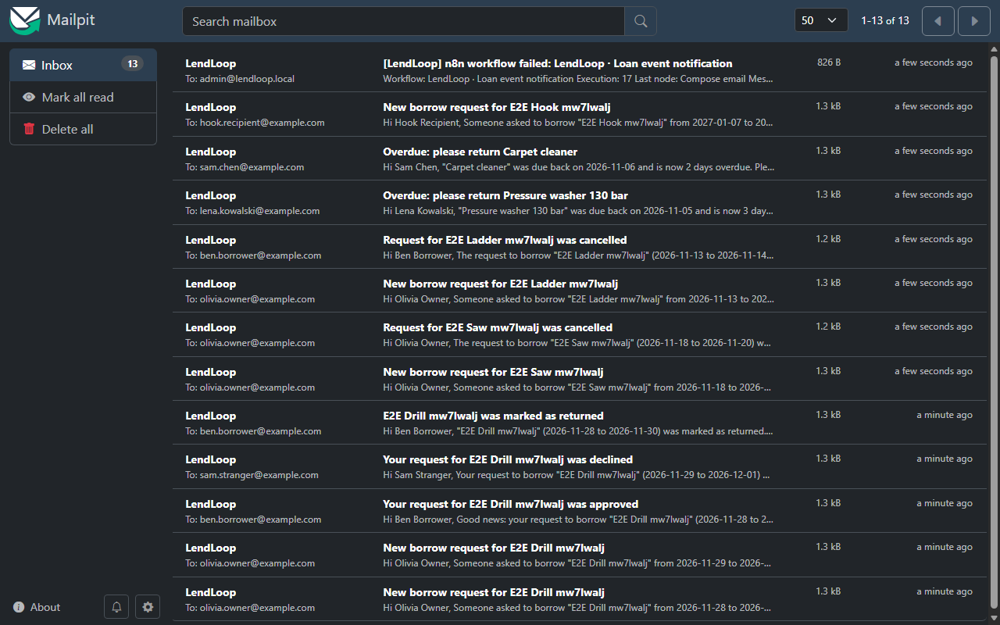

# End-to-end API test results

Date: 2026-11-08. Script: `scripts/e2e/run-e2e.mjs` (node 24, no dependencies). Latest run: 75 PASS, 0 FAIL, 0 SKIP. Emails captured by the SMTP sink in that run: 13. (An earlier run had 1 SKIP in step 10 because the temporary n8n install had been deleted from disk; after reinstalling n8n and re-provisioning it with `n8n/scripts/bootstrap.mjs`, every step passes.)

Stack (all real, nothing mocked): local Convex anonymous deployment (`npx convex dev`, API 127.0.0.1:3210, HTTP actions 3211), n8n 2.46.6 (npm install, 3 published LendLoop workflows) on 127.0.0.1:5678, a Node SMTP capture sink on 127.0.0.1:1025 writing `.eml` files, `next dev` on :3000 with dummy Clerk keys. Convex functions are called AS a user through `npx convex run --identity` (fresh test identities with issuer `https://e2e.local`), so every authorization check runs the real server code path.

| Step | Scenario | Result | Key evidence |
|---|---|---|---|
| 1 | Reset + seed, public listing, landing page | PASS | `seed:run` returned users 8, tools 27 (26 active), loans 17; `listPublic` rows have exactly `{name, category}`, names unique, removed tool hidden; `GET /` contains "Kids bike trailer" |
| 2 | Identities | PASS | owner/borrower/stranger/admin provisioned; `users:me` keys are exactly `_id,email,name,role,trustedLender`; null when signed out; admin promoted via internal `admin:promoteToAdmin` |
| 3 | Owner lists tools, validation | PASS | 3 tools created; name "x" gives `VALIDATION`; bad category is rejected by the Convex arg validator (`ArgumentValidationError`, before the handler, so no `VALIDATION` code) |
| 4 | Borrower request, email, outbox | PASS | pending loan; owner email "New borrow request for ..." captured; `automationEvents` `request_created` is `delivered` |
| 5 | Negative authorization | PASS | stranger approve and borrower approve: `NOT_FOUND`; owner borrowing own tool: `VALIDATION`; past start date: `VALIDATION`; signed out approve/request: `UNAUTHENTICATED` |
| 6 | Approve, auto-decline, conflict | PASS | borrower "approved" email, event delivered; overlapping pending request auto-declined with its own "declined" email; new overlapping request: `CONFLICT` |
| 7 | Return, invalid transitions | PASS | borrower "marked as returned" email; return twice and approve returned: `INVALID_TRANSITION` |
| 8 | Borrower cancel | PASS | owner "was cancelled" email; owner calling borrower-only cancel: `NOT_FOUND` |
| 9 | Admin moderation | PASS | non-admin `listLoans`/`removeTool`: `FORBIDDEN`; `setTrustedLender` writes `user.trusted.grant` audit row; self-trust `FORBIDDEN`; `removeTool` cancelled 1 pending loan, borrower email, tool gone from `listPublic`, `tool.remove` audit row with reason |
| 10 | Overdue reminders (WF2) | PASS | `n8n execute --id=lendloopWf02` exit 0; 2 reminder emails captured (Pressure washer 130 bar, Carpet cleaner); +2 Convex `reminders` rows; second run idempotent (rows 3 to 3, emails 2 to 2) |
| 11 | Inbound HTTP security | PASS | no or wrong token: 401; valid: 200; duplicate reminder POST: 200 `duplicate`; 20 KB body: 413; bad body: 400; POST health and PUT overdue-loans: 405 |
| 12 | Webhook security (direct to n8n) | PASS | valid signed event 200 `delivered` and email; replay same eventId 200 `duplicate`, no second email; bad signature 401; timestamp -400 s 401; no email for rejected events |
| 13 | Error path | PASS | unsupported `eventType` gave n8n 500; admin alert email "[LendLoop] n8n workflow failed: ..." captured; `admin:listWorkflowErrors` gained a row (1 to 2); non-admin gets `FORBIDDEN` |
| 14 | UI smoke | PASS | `/`, `/dev/preview`, `/manifest.webmanifest`, `/icon.svg` all 200. `/dashboard` signed out: 307 redirect to the Clerk sign-in URL (`https://example.accounts.dev/sign-in?...`). The route is protected by the Clerk middleware (`proxy.ts`); with dummy keys the redirect target is a placeholder host, so sign-in itself cannot work, as expected |

## Notes

- Seed note: the seed contains 27 tools (26 active plus one removed), not 26.
- Each run wipes all app data on the dev deployment (step 1, `seed:reset`), so it is safe to re-run any time. Test identities are recreated each run; tool names carry a per-run suffix so email matching is unambiguous.
- Steps are driven by a ~2 s per call Convex CLI, so a full run takes about 2 minutes.
- No application bugs were found in this run.

## How to re-run

```bash
# stack must be up: npx convex dev, n8n with the 3 workflows published, SMTP sink, next dev
npm run e2e:api
```

Environment overrides (all optional): `E2E_MAILPIT_URL` (read emails from Mailpit's API instead of `E2E_INBOX_DIR`), `E2E_N8N_DOCKER_DIR` (run step 10 via `docker compose exec` in that compose dir), `E2E_INBOX_DIR` (sink output dir), `E2E_N8N_URL`, `E2E_CONVEX_SITE_URL`, `E2E_APP_URL`, `E2E_INBOUND_TOKEN_FILE`, `E2E_WEBHOOK_SECRET_FILE` (when unset or missing, the secrets are read with `convex env get`; they are never printed), `E2E_N8N_ENV_FILE` (bash file sourced before running the n8n CLI in step 10; it must export `N8N_RUNTIME_DIR` and a spare `N8N_RUNNERS_BROKER_PORT`, e.g. 5689), `E2E_BASH`. The script exits 1 on any FAIL and is not part of `npm run check` because it needs the live stack.

## Not covered

- Real Clerk browser sign-in (needs real Clerk keys; identities here are injected through the Convex CLI, which skips JWT verification but not any app-level check).
- Docker on Linux hosts (the Docker path itself is covered in "Docker run" below).
- Convex retry/backoff when SMTP is down (covered in `n8n/E2E-RESULTS.md` scenario 8).
- Browser rendering of signed-in pages, photos upload, the daily cron jobs.

## Docker run

Date: 2026-11-08. Windows 11, Docker Desktop 29.9.2, Docker Compose v5.6.1. Images: `docker.n8n.io/n8nio/n8n:2.46.6`, `axllent/mailpit:v1.33.0`. Both services reached `healthy` on the first `docker compose up -d` (n8n healthcheck is the node-based `fetch` of `/healthz`; Mailpit uses `/mailpit readyz`), and again after `docker compose restart n8n`.

Result: **75 PASS, 0 FAIL, 0 SKIP**, 13 emails captured by Mailpit in the run. Command:

```bash
E2E_MAILPIT_URL=http://127.0.0.1:8025 E2E_N8N_DOCKER_DIR=<abs path of n8n/>   E2E_INBOUND_TOKEN_FILE=<file> E2E_WEBHOOK_SECRET_FILE=<file> npm run e2e:api
```

Setup checks: bootstrap in docker mode imported 2 credentials and 3 workflows and published them; the encryption key is mounted at `/run/secrets/n8n_encryption_key` and only `N8N_ENCRYPTION_KEY_FILE` exists in the container env; no `lendloop-creds-*` temp dir remains; unsigned POST to the webhook returns 401; Mailpit UI and `/api/v1/messages` return 200. Step 10 ran `docker compose exec -T -e N8N_RUNNERS_BROKER_PORT=5689 n8n n8n execute --id=lendloopWf02` while the server was running (exit 0, 2 reminder emails, idempotent second run). Step 14 ran against `next dev` with dummy Clerk keys. Convex ran on the host; n8n reached it through `host.docker.internal:3211`.

Fixes needed: (1) `n8n/scripts/bootstrap.sh` failed under Git Bash because MSYS rewrote `/scripts/bootstrap.mjs` to `C:/Program Files/Git/scripts/bootstrap.mjs`; the script now exports `MSYS_NO_PATHCONV=1` and `MSYS2_ARG_CONV_EXCL="*"`. (2) `scripts/e2e/run-e2e.mjs` gained the Mailpit and docker modes. No compose file change was needed.

Not covered: Linux hosts (secret file permissions) and macOS.


